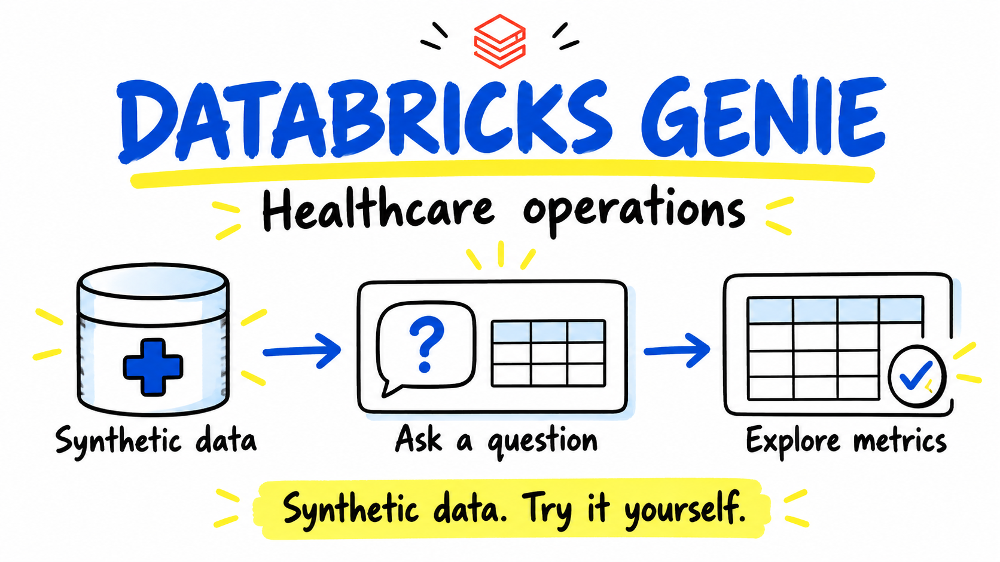
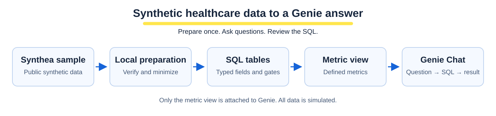

# Databricks Genie healthcare demo

Try Genie with public synthetic healthcare data. Deploy a prepared metric view and Genie Agent, ask an operations question, and inspect the SQL behind the answer.



**[Start the demo](docs/QUICKSTART.md)** · **[Data and metrics](docs/data-and-metrics.md)** · **[Example answer](docs/sample-answer.md)**

## What you can try

- Encounter counts by year, quarter, or encounter class.
- Simulated claim cost and payer coverage by payer category.
- Unique synthetic patients and encounters per patient.
- Questions in plain English, with generated SQL and result tables.

The demo uses the official Synthea sample. The pinned archive has **108 distinct synthetic patients and 5,571 encounters**. A preparation script downloads and verifies it, removes unused columns, and maps private payer names to categories before upload.

The Genie Agent has one Unity Catalog metric view attached. It defines five dimensions and eight measures. Synthetic IDs remain in the underlying tables and staging volume; they are not metric-view fields.

## Get started

Use **Linux, Python 3.12, uv, and Databricks CLI 1.20.0**. You need an authenticated Databricks profile, Unity Catalog permissions, and an existing pro or serverless SQL warehouse. Native Windows is unsupported; use a Linux environment. This project has not been validated in Free Edition.

```bash
git clone https://github.com/mkhomutskyi/synthea-healthcare-genie-demo.git
cd synthea-healthcare-genie-demo
uv sync --locked
uv run python scripts/verify_contracts.py
uv run python scripts/download_and_verify.py --stage
```

Next, follow the [quick start](docs/QUICKSTART.md) to choose your catalog, schema, warehouse, and profile. Workspace commands print a plan until you add `--execute`. Deployment uses your existing warehouse; SQL work can start it and incur charges.

You do not need to run an evaluation suite before exploring Genie.



## Repository guide

| Path | Purpose |
|---|---|
| [docs/QUICKSTART.md](docs/QUICKSTART.md) | Deploy, ask your first questions, and clean up |
| [docs/data-and-metrics.md](docs/data-and-metrics.md) | Source data, fields, formulas, and limits |
| [docs/sample-answer.md](docs/sample-answer.md) | A reference result for one operations question |
| [docs/evaluation.md](docs/evaluation.md) | Optional answer checks and boundary questions |
| [docs/results.md](docs/results.md) | Short summary of the recorded experiment |
| [sql/](sql/) | Tables, metric view, reference SQL, and cleanup |
| [genie/](genie/) | Agent settings, instructions, and SQL examples |
| [evaluation/](evaluation/) | Questions, checked SQL, and reference digests |
| [scripts/](scripts/) | Prepare data, deploy, check answers, and clean up |
| [tests/](tests/) | Offline tests and separate artifact checks |

## Scope

This is a learning example for healthcare and life sciences teams. The data demonstrates **healthcare operations**, not clinical trials or drug discovery. Every patient, date, and amount is simulated.

It does not provide medical advice or support care, coverage, or payment decisions. It makes no claims about real populations or HIPAA compliance. Genie instructions guide behavior; they do not guarantee it. Review answers and generated SQL.

Original code and documentation are licensed under Apache-2.0. See [LICENSE](LICENSE) and [third-party notices](THIRD_PARTY_NOTICES.md) for attribution and upstream data terms.
