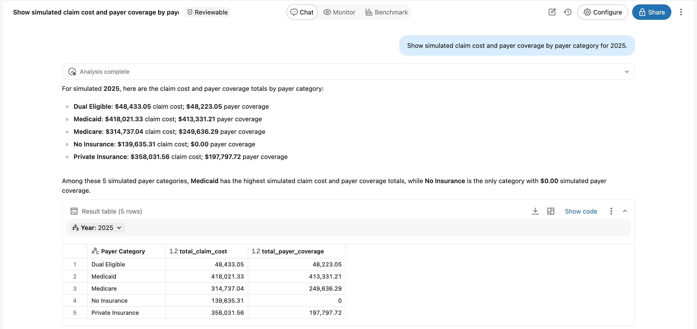
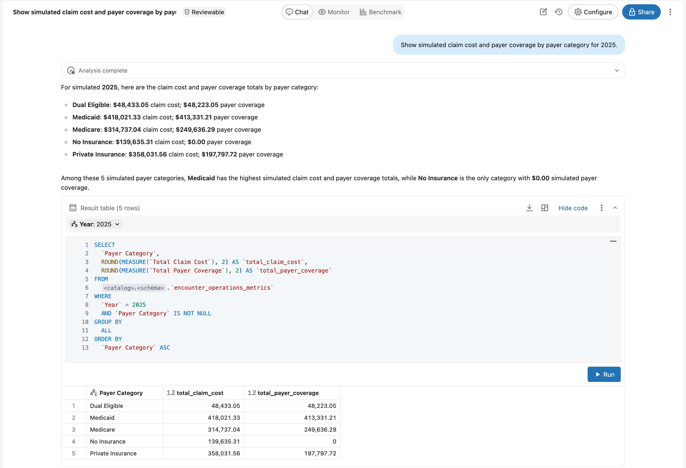

# Example healthcare operations answer

Ask Genie in Chat mode: **Show simulated claim cost and payer coverage by payer category for 2025.**

## Genie Chat

*Genie returns five payer categories for simulated 2025. Open the image to enlarge it.*

## Generated SQL

Select **Show code** for the same answer.

*Generated SQL for the same answer. Catalog and schema names are replaced with placeholders.*

## Reference result

The table below is the independently computed reference for the pinned synthetic sample. The claim cost and payer coverage columns match all five rows in the screenshots. It also includes cost not covered by payer and coverage rate. Results describe this small synthetic sample only.

| Payer category | Claim cost | Payer coverage | Cost not covered by payer | Coverage rate |
|---|---:|---:|---:|---:|
| Dual Eligible | 48433.05 | 48223.05 | 210.00 | 0.9957 |
| Medicaid | 418021.33 | 413331.21 | 4690.12 | 0.9888 |
| Medicare | 314737.04 | 249636.29 | 65100.75 | 0.7932 |
| No Insurance | 139635.31 | 0.00 | 139635.31 | 0.0000 |
| Private Insurance | 358031.56 | 197797.72 | 160233.84 | 0.5525 |

Coverage Rate is a fraction. For example, 0.4567 means 45.67%. Do not average the category rates to get an overall rate.

In Genie, inspect the generated SQL with **Show code**. Check the year, payer grouping, and metric definitions. Results may use different labels or row order; the meaning and values should still match.

[Metric definitions](data-and-metrics.md) · [Optional answer checks](evaluation.md)
